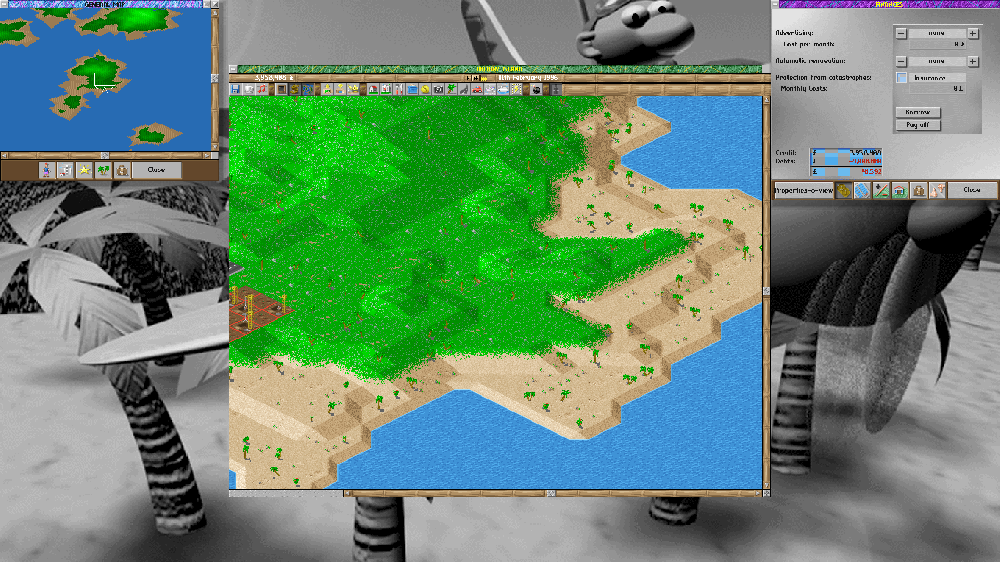
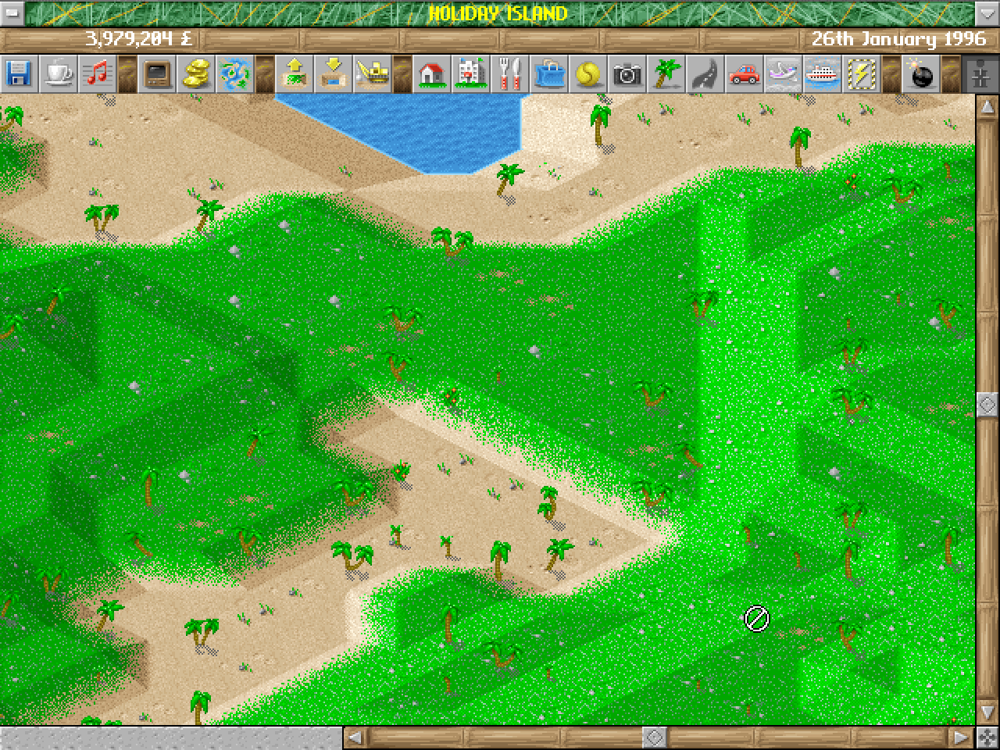
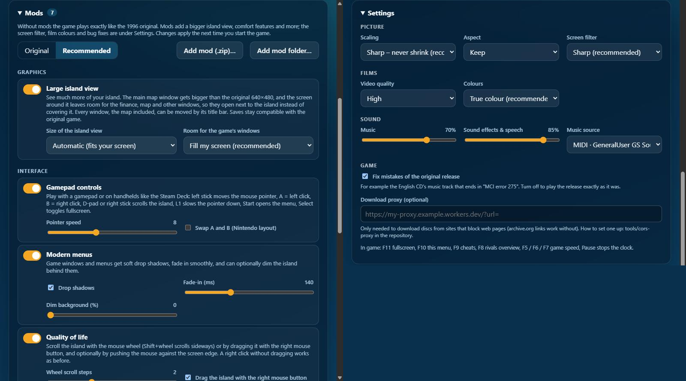
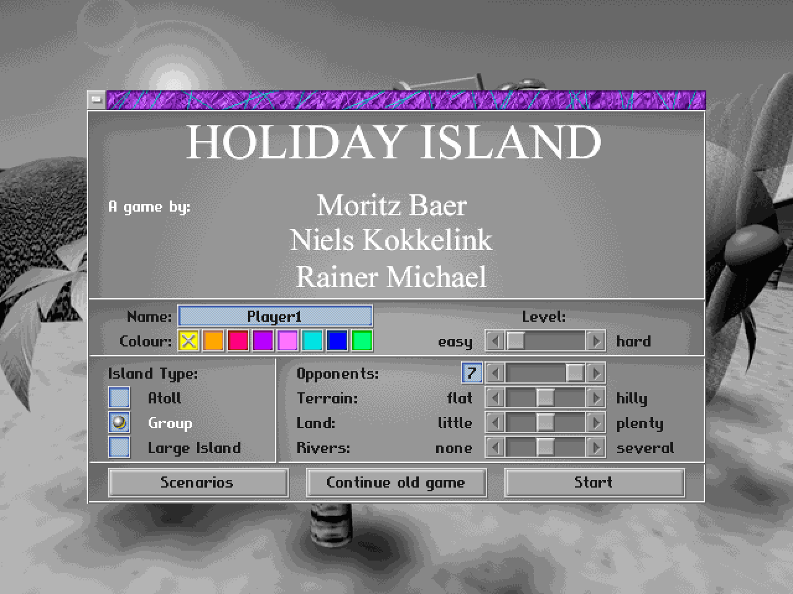
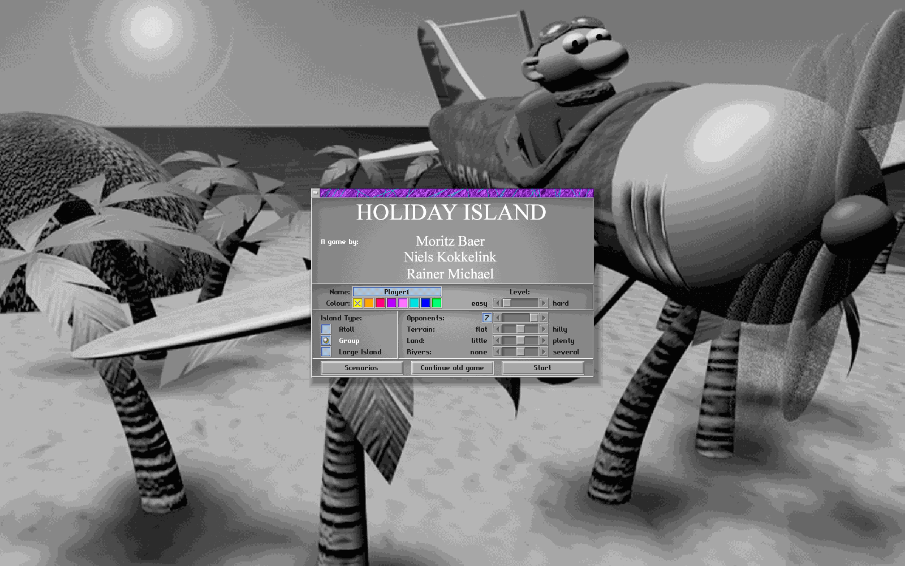

# Project Sunburn

**Holiday Island (1996) for modern systems** – Windows, macOS, Linux, Steam Deck and the browser.

[**▶ Play in the browser**](https://emil007.github.io/Project-Sunburn/) ·
[**⬇ Downloads**](https://github.com/Emil007/Project-Sunburn/releases/latest) ·
[Modding guide](MODDING.md)

You need your own Holiday Island CD (English or German) as a disc image. No game data is included.

<p align="center">
  
</p>

| The original, as in 1996 | Launcher with disc library and mods |
|---|---|
|  |  |
|  |  |

> **Disclaimer: 100% AI.** This port (the Win16 runtime, the launcher, the mods, the tools and this
> documentation) was written entirely by an AI (Claude, by Anthropic), directed and tested by a human.
> No line of code was written by hand. Expect AI-typical mistakes, and please report what you find.

A port of **Holiday Island** (Sunflowers, 1996) to Windows, macOS, Linux and the web browser.

The game is a 16‑bit Windows 3.1 program written in Delphi 1. This port doesn't ship any game data.
It contains a purpose-built Win16 runtime that runs the original program code from **your own CD**.
It also reimplements the Windows 3.1 services the game uses, on top of modern technology:

| Original (1996)                        | This port                                                        |
|----------------------------------------|------------------------------------------------------------------|
| 16‑bit x86 CPU + 387 FPU               | Interpreter in TypeScript (verified against Unicorn/QEMU)        |
| Windows 3.1 KERNEL/USER/GDI            | Reimplemented: windows, messages, palettes, DIBs, fonts, timers  |
| VGA/VESA 640×480×256                   | WebGL 2 renderer, screen filters and bigger desktops as mods     |
| WaveMix DLL sound mixer                | WebAudio mixer                                                   |
| MIDI on a 1996 sound card (calypso!)   | **GeneralUser GS** SoundFont synth (spessasynth)                 |
| Video for Windows (Cinepak/MS‑ADPCM)   | Built‑in Cinepak and ADPCM decoders                              |
| CD‑ROM drive + installer               | Reads .iso / .bin+.cue / .mdf+.mds images directly; the install is rebuilt automatically |

Both the **English** and the **German** releases are supported. The game language is whatever
the disc you add is, and you can keep both in the library and switch between them.

## Playing

You need the original **Holiday Island CD** (English or German) as a disc image: `.iso`,
`.bin`+`.cue` or `.mdf`+`.mds`. The port contains no game data.

Add it in the launcher by dropping the files, or paste a **download link** – a download page, an
archive.org item or a direct link. The launcher finds the disc image behind the link, unpacks `.zip`
files and keeps only the image. Where it works:

* **Desktop app:** any site. If a page needs a click or a browser check, it opens in a window: start the
  download there and the launcher takes it over.
* **Web version:** archive.org and sites that allow downloads from other web pages (CORS). For other sites,
  download the file yourself and drop it in, or set up the optional [download proxy](tools/cors-proxy).

### Windows
Extract `ProjectSunburn-<version>-win-x64.zip` (or `-arm64`) and start `Project Sunburn.exe`.

### macOS
Open `ProjectSunburn-<version>-mac-arm64.dmg` (Apple Silicon) or `-x64.dmg` (Intel) and drag the app to
Applications. The app isn't notarized by Apple: the first time, right-click it → **Open**, or run
`xattr -cr "/Applications/Project Sunburn.app"`.

### Linux, Steam Deck and Linux handhelds
Run `ProjectSunburn-<version>-linux-x86_64.AppImage` (`chmod +x` first), or extract the `.tar.gz` and
run `project-sunburn`. ARM64 builds (Raspberry Pi, ARM handhelds) are included as `-arm64`.
On the Steam Deck, add the AppImage to Steam as a non-Steam game. With the **Gamepad controls** mod
(on by default):

| Gamepad | Action |
|---|---|
| Left stick | move the mouse pointer (L1 / L2 = slow) |
| A / B | left / right mouse button (swappable for Nintendo layout) |
| D-pad, right stick | scroll the island |
| Y / X | Enter / Escape |
| Start / Select | menu / fullscreen |

### Browser and installable web app (also Android and iPad)
The web version runs in Chrome, Edge and Firefox, and in Safari 17+. On phones and tablets it can be
installed: **Install app** at the bottom of the launcher (Chrome/Edge/Android), or Share → **Add to Home
Screen** (Safari). After the first start it works offline. Touch controls: tap = click, hold = right
click, drag = drag, two fingers = scroll the island, three-finger tap = menu.

To host it yourself, any static web server works, because `coi.js` provides the cross-origin isolation
the emulator needs (`npm run serve` for a local test). The official build is at https://emil007.github.io/Project-Sunburn/.

Disc images are imported once into the browser's private storage (OPFS). Nothing is uploaded anywhere.

### Saves
Savegames (`MAPS\*.MAP`), high scores and other files the game writes are kept per language in private
storage and restored on the next start. **Export saves** / **Import saves** next to each disc in the
launcher move them as a `.zip` (or single `.MAP` files). The format is the game's own and the same in
the English and the German release, so saves can go from one version to the other, between the web and
the desktop app, between devices, and to or from the original game's `MAPS` folder.

### Controls & options
* **F11**: fullscreen. **F10**: menu (scaling, aspect, volumes, video quality, fullscreen, quit to launcher).
* The picture is never scaled down: game pixels are shown 1:1 (or 2×, 3× … when there is room, and
  on high‑DPI screens). A smaller window shows less of the screen instead of a smaller, blurry
  picture, and game windows that would end up outside are moved back into view. "Fit to window"
  under Settings → Scaling restores free scaling.
* The game's own options (music track, volumes, game speed …) work as in the original.
* Game windows can be dragged by their title bar, as in the original.

## Original game + mods
Without mods the port shows the game as it was in 1996: 640×480, 256 colours, pixels scaled with plain
nearest‑neighbour. Every improvement is a **mod** you switch on in the launcher (**Mods**). The
**Recommended** preset is on by default and **Original** turns everything off. Mods take effect at the
next start.

| Mod | What it does |
|---|---|
| Sharp pixels *(recommended)* | Even, square pixels at any scale (integer prescale + bilinear). |
| Smooth / CRT monitor / Edge smoothing (Scale4x) | Alternative screen filters. |
| True‑colour video *(recommended)* | Films decoded in true colour instead of dithered to 256 colours. |
| Large island view *(experimental)* | The main map fills a bigger window (800×600 up to 2560×1440). The map renderer, mouse picking, window chrome and the desktop background are patched by signature, and saves stay compatible with the original. Optional **desktop**: the screen is bigger than the map window, so the game's windows (finances, overview map, …) open next to the map instead of on top of it, and every window, the map included, can be dragged around. |
| Modern menus *(recommended)* | Drop shadows, fade‑in, optional dimming behind game windows. |
| Gamepad controls *(recommended)* | Gamepad / Steam Deck controls, see above. |
| Quality of life *(recommended)* | Scroll the island with the mouse wheel or by dragging with the right mouse button, optional edge scrolling. |
| Autosave *(recommended)* | Saves on the 1st of every in‑game month as `AUTOyymm` and keeps the newest 5 (adjustable). Load them like any other save. |
| Game speed *(recommended)* | Three buttons in front of the date, drawn in the game's own style: ▶ normal, ▶▶ 2×, ▶▶▶ 5×, with tooltips. |
| Unlock all buildings | Off by default. Every building is in the build menus from day one instead of appearing during the game. Optional: build the auction landmarks (Stonehenge, Eiffel Tower, …) from the Attractions menu at their auction starting price. |
| Cheat without penalty | Off by default. The original money cheat (hold **Ctrl + Shift + Alt** and press **G**: +1,000,000,000) marks your game and you can no longer win. With this mod you keep the money and can still win. |
| Skip intros | Skip the intro film and/or the flight to the island after Start. |
| Custom SoundFont | Play the music with your own .sf2/.sf3. |
| Currency | Replace DM / £ in all game texts, e.g. with € (also $, ¥, CHF, öS, ₿, custom). Missing symbols are drawn into the game's own bitmap font. |
| Original bug fixes *(recommended)* | E.g. the English release asks for `floatin'.mid` but installs `FLOATIN.MID` ("MCI error 275"). |

Mods are folders or `.zip` files with a `mod.json`. They can replace game files, add screen shaders,
patch the game's code, edit its forms, hook Windows calls, add UI helpers or bring a SoundFont.
**[MODDING.md](MODDING.md)** documents the format. `examples/sepia-island` is a small example to start from (also attached
to every release as `sepia-island-example-mod.zip`).

## What the port always does (not mods)
* Fixes that make the game run correctly on a modern system without touching your files. Win16
  programs build names like `GELD    .BMP` (blank‑padded 8.3 names). DOS ignored the blanks but modern
  file systems don't, which caused the well‑known "couldn't find image …" error when the TV starts.
  The runtime handles these names the DOS way. Empty (0‑byte) sound files play as silence instead
  of raising MCI errors. No renaming or replacing of game files is needed.
* Music through a high‑quality GM/GS SoundFont instead of a 1996 OPL3/wavetable card. The calypso and
  samba tracks get proper steel drums, percussion and brass.
* No installer, no 256‑colour mode switch, no VESA driver, no CD swapping. Startup takes seconds.
* Fault tolerance: if the original code hits a protection fault, it goes through the game's own Delphi
  exception handler, as on real Windows, instead of killing the process.

## Building from source

```
npm ci
npm run build            # web version -> dist/web   (npm run serve: http://localhost:8080)
npm run desktop:prepare  # minified web build copied into electron/web
cd electron && npm ci
npx electron-builder --linux AppImage tar.gz --x64 --arm64   # or --win zip / --mac dmg zip
```

**Releases are built by GitHub Actions.** Raise `"version"` in `package.json` and push to `main` (or push a
tag like `v1.2.0`): `.github/workflows/release.yml` builds Windows (x64/arm64), macOS (x64/arm64),
Linux (x64/arm64) and the web version, creates the tag and publishes a GitHub release with all files. `pages.yml` publishes the web version on GitHub Pages on every push to `main`
(enable it under Settings → Pages → Source: GitHub Actions). `ci.yml` type-checks and builds pull requests.

Tests and tools:
* `npm run harness`, then `node build/harness.js --disc <image> --ms 60000 --out shots`. This is a
  headless runner with scripted input (`--script`), screenshots, mods (`--mods id[=json]`) and API, file,
  MCI and DOS tracing.
* `python3 tools/e2e_browser.py --disc <image files>` is a browser smoke test with Playwright.
* `python3 tools/difftest.py <seed> <n>` is a randomized CPU differential test against Unicorn.

## Layout
```
src/core      x86 CPU (16/32‑bit, protected mode selectors) and x87 FPU
src/win16     NE loader, KERNEL/DOS/DPMI, USER, GDI, MMSYSTEM/MCI, WAVEMIX, TOOLHELP, WIN87EM
src/media     Cinepak, AVI, WAV/ADPCM, MIDI timing
src/assets    ISO9660/BIN/CUE/MDS disc reader, LZHUF unpacker for the Sunflowers installer, install builder
src/platform  Browser host: emulator worker (SharedArrayBuffer protocol), launcher + mod manager, WebGL, audio
src/mods      Mod runtime (file overlays, code patching, API hooks, DFM form editor)
web/mods      Built‑in mods (also the best examples)
electron      Desktop shell (serves the web build with cross‑origin isolation)
```

## Legal
This repository contains no part of Holiday Island: no code, graphics, sound, music, video or text,
apart from the screenshots in `docs/screenshots`, which show the game running in this port.
The game runs from the player's own CD. The port's own code is MIT‑licensed (see `LICENSE`).
Bundled third‑party components are listed in `THIRD_PARTY_NOTICES.md`.

## Credits & licenses
* Holiday Island © 1996 Sunflowers Interactive. Game data comes from your own CD and isn't included.
* GeneralUser GS SoundFont © S. Christian Collins, redistributed under its license (see `web/soundfont/LICENSE.txt`).
* spessasynth_lib (Apache‑2.0) for SoundFont synthesis.
* Interface font glyphs rendered from DejaVu Sans (Bitstream Vera license).
